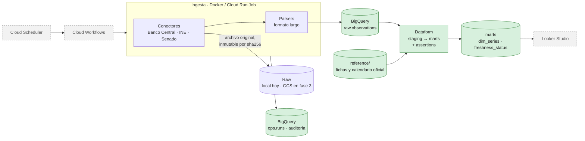

# Síntesis Económica V2

Pipeline ELT en Google Cloud que automatiza los indicadores económicos de la Región de Valparaíso y de Chile
(Banco Central, INE, Senado), pensado para correr **sin intervención de su autor** y con cada decisión documentada.

> **Estado (noviembre 2026):** fases 0 y 1 cerradas; fase 2 (BigQuery + Dataform) en curso. Rebanada vertical:
> una sola fuente (Banco Central: UF e IMACEC) recorre todo el pipeline antes de sumar las demás.
> Plan completo en [docs/plan.md](docs/plan.md).

## El problema

La versión 1 de este proceso funciona, pero solo en un PC y con una persona al frente: rutas a Google Drive,
transformaciones en Power Query dentro de un Excel, estado guardado en un JSON y pasos manuales. V2 lo reconstruye
desde cero como un pipeline que cualquiera con un proyecto GCP puede desplegar y auditar.

## Arquitectura



Verde: construido · gris punteado: planificado. Infraestructura con Terraform, IAM de mínimo privilegio por servicio
y CI/CD con GitHub Actions + Workload Identity Federation llegan en las fases 3–5.

## Lo que ya funciona

- **Ingesta idempotente.** Conector de la API del Banco Central sobre un contrato común ([ADR-0003](docs/adr/0003-conectores-de-ingesta.md)):
  el archivo original se guarda una sola vez por sha256 y una segunda corrida no duplica nada.
- **Contenedor endurecido.** Imagen Docker multi-stage, usuario sin privilegios, credenciales solo por variables de entorno;
  un test corre la imagen aislada (sin repo, sin credenciales y sin red).
- **Carga a BigQuery** con esquema explícito, tabla particionada por mes y clusterizada por `(source_id, series_id)`.
- **Transformación en Dataform** ([ADR-0001](docs/adr/0001-elt-gcs-bigquery-dataform.md)): staging que resuelve las
  revisiones de cifras (*vintages*), dimensión de series y assertions estructurales que cortan la corrida si fallan.
- **Control de frescura con calendario oficial.** `marts.freshness_status` compara lo que el calendario de publicaciones
  anunciaba con lo que realmente llegó, por fuente (OK / ATRASADO).
- **Observabilidad desde el inicio.** Logs JSON estructurados (`run_id`, `source_id`, `severity`) listos para Cloud Logging
  y una tabla de auditoría por corrida (`ops.runs`: archivos nuevos, filas, duración, error).
- **Seguridad.** `detect-secrets` en pre-commit, credenciales redactadas en logs y tests con credenciales "canario"
  que fallan si un secreto se filtra.
- **126 tests** (`make test`) y linting con `ruff` en pre-commit.

## Decisiones de arquitectura

| Decisión | Elegido | Por qué (resumen) |
|---|---|---|
| Dónde transformar | ELT: GCS → BigQuery → **Dataform** | El original queda auditable; Dataform es nativo de BigQuery ([ADR-0001](docs/adr/0001-elt-gcs-bigquery-dataform.md)) |
| Orquestación | **Cloud Scheduler + Workflows** | Flujo lineal y corto; Composer tiene costo fijo alto a esta escala ([ADR-0002](docs/adr/0002-orquestacion-workflows.md)) |
| Ingesta | **Conectores propios** con contrato común | Tres patrones de extracción distintos (API, scraping, xlsx) ([ADR-0003](docs/adr/0003-conectores-de-ingesta.md)) |
| Estrategia | **Rebanada vertical** | Un pipeline completo con una fuente vale más que uno a medias con tres |

## Hoja de ruta

| Fase | Contenido | Estado |
|---|---|---|
| 0 | Fundaciones: uv, ruff, pytest, pre-commit, configuración y logging | ✅ |
| 1 | Ingesta del Banco Central + Docker | ✅ |
| 2 | BigQuery + Dataform: staging, marts, assertions, frescura | 🔄 en curso |
| 3 | Fundación GCP con Terraform (GCS, IAM, Secret Manager) | ⏳ |
| 4 | Despliegue en Cloud Run Jobs + orquestación con Workflows | ⏳ |
| 5 | CI/CD con GitHub Actions y Workload Identity Federation | ⏳ |
| 6 | Ensanche: Senado e INE regional | ⏳ |
| 7 | Dashboard en Looker Studio | ⏳ |

## Stack

Python 3.13 · uv · pydantic-settings · pytest · Docker · BigQuery · Dataform (SQLX) · Cloud Storage · Cloud Run ·
Cloud Workflows · Terraform · GitHub Actions

## Documentación

- [Plan del proyecto](docs/plan.md) · [Guía del código](docs/codigo.md) · [Fuentes](docs/fuentes.md)
- [Decisiones (ADR)](docs/adr/) · [Planes por tarea](docs/plans/) · [Registro de aprendizaje](docs/aprendizaje/)

## Desarrollo local

Requisitos: [uv](https://docs.astral.sh/uv/) y `make` (en WSL/Linux).

```bash
make setup   # instala dependencias y los hooks de pre-commit
make test    # corre los tests
make lint    # corre ruff, detect-secrets y los demás hooks sobre todo el repo
make run-local SOURCE=bcentral_uf   # corre una fuente: descarga, guarda en raw y escribe las observaciones
```

`run-local` necesita un `.env` (ver `.env.example`) con `SINTESIS_CONTACT_EMAIL` y, para el Banco Central,
`SINTESIS_BDE_USER` y `SINTESIS_BDE_PASSWORD`. Los datos quedan en `./data` (ignorada por git):
- `data/raw/source=<id>/ingest_date=<AAAA-MM-DD>/<sha256>_<nombre>`: lo que entregó la fuente, tal cual y una sola vez.
- `data/observations/source=<id>/<sha256>.csv`: `source_id, series_id, period, value, file_sha256, raw_path, ingest_date`
  (`raw_path` relativa a `data/raw/`; `ingest_date` = fecha del primer guardado del raw).
- `data/ops/runs.jsonl`: una línea por fuente y corrida (`status`, `new_files`, `existing_files`, `rows_written`, `duration_s`, `error`).

Carga a BigQuery (`raw.observations`, `ops.runs` y los CSV de `reference/`, en us-central1): `make load`. Requiere las credenciales de GCP (abajo)
y `SINTESIS_GCP_PROJECT` en el `.env`. Cada carga reemplaza las tablas completas desde estos archivos (`WRITE_TRUNCATE`).

Código de salida: 0 todo bien · 1 alguna fuente falló (las demás siguen) · 2 la corrida no pudo empezar.

### Docker

Requisito: Docker (en Windows, Docker Desktop con la integración de WSL activa).

```bash
make docker-build                    # construye la imagen sintesis-ingest:local (ingest/Dockerfile)
make docker-run SOURCE=bcentral_uf   # corre una fuente en un contenedor; datos en ./data (o DATA_DIR=<carpeta>)
make test-docker                     # prueba la imagen aislada: sin repo, sin credenciales y sin red
```

La imagen no contiene el `.env` ni los tests: las credenciales entran como variables de entorno al correr
(como en Cloud Run) y `./data` se monta en `/app/data`. Corre como usuario sin privilegios.

### Credenciales de GCP (fase 2, prueba gratuita)

La fase 2 usa BigQuery con tu usuario de Google. El login lo hace la persona en su terminal (en Claude Code, con `!`),
nunca el asistente:

```bash
gcloud auth login                                      # credencial de gcloud y bq
gcloud config set project <ID_DEL_PROYECTO>
gcloud auth application-default login                  # credencial ADC: la usan las librerías (Python, Dataform)
gcloud auth application-default set-quota-project <ID_DEL_PROYECTO>   # solo si el login no lo dejó configurado
```

Ambas credenciales viven en `~/.config/gcloud/` y guardan un *refresh token* que no vence solo: quien lea esos archivos
puede actuar como tú en GCP. Barreras en `.claude/settings.json`:
- `deny` de lectura sobre `~/.config/gcloud/**`: seguro para la herramienta Read; sobre Bash, `cat`/`head`/`sed`
  quedan bloqueados (probado), pero es una protección de mejor esfuerzo.
- `deny` de los comandos que imprimen tokens: `gcloud auth print-*`, `gcloud auth application-default print-*`,
  `gcloud config config-helper`.
- `ask` sobre `gcloud auth *`: el asistente no puede autenticar ni revocar sin permiso.

**Riesgo residual (aceptado mientras dure la prueba gratuita):** las reglas no frenan `grep -r` ni un subproceso
cualquiera que lea el archivo, ni variantes con opciones globales antes del subcomando (`gcloud --project X auth print-...`);
eso solo lo haría el sandbox de Claude Code, que se reevalúa **al pasar a cuenta pagada**. Desde el 2026-11-06 el proyecto
usa la prueba gratuita de GCP (`billingEnabled: true`): Google no cobra durante la prueba, así que una credencial filtrada
podría gastar crédito o crear recursos, pero no cobrar a la tarjeta; el presupuesto (CLP 10.000 mensual) avisa por correo.
Quien tenga la credencial actúa como tu usuario en todos los recursos de GCP de la cuenta.

Tampoco puedo tocar la facturación sin permiso: `ask` sobre `gcloud billing *`.

Revocar (si se sospecha una fuga, o al terminar):

```bash
gcloud auth application-default revoke
gcloud auth revoke
```

### Transformación (Dataform)

El proyecto Dataform (SQLX) vive en `transform/`. Su CLI es una herramienta de desarrollo y CI: en producción, Dataform
corre como servicio administrado de Google (ADR-0001), por eso Node no va en la imagen de ingesta.

Requisitos: credenciales de GCP (arriba) y Node.js con [nvm](https://github.com/nvm-sh/nvm) (versión en `.nvmrc`,
como `.python-version` para Python):

```bash
nvm install                # instala la versión de .nvmrc
make transform-setup       # instala la CLI de Dataform fijada en package-lock.json (en ./node_modules)
npx dataform init-creds transform   # una vez: elegir ADC; crea transform/.df-credentials.json (sin secretos, ignorado por git)
make transform-compile     # compila el SQLX sin tocar BigQuery
make transform             # ejecuta contra BigQuery (datasets en us-central1)
```

El proyecto GCP y la región están en `transform/workflow_settings.yaml`, el archivo de configuración propio de Dataform
(excepción a la regla de configurar por variables de entorno; ver ADR-0001).

Por defecto solo se usan `table` y `view`; `incremental` requiere un ADR. En el sandbox (sin facturación, hasta el
2026-11-06) una tabla `incremental` funcionaba la primera vez y fallaba desde la segunda, porque usa DML.
