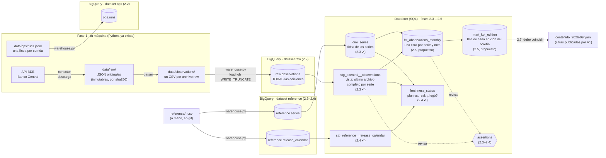

# Mapa del pipeline (fase 2, rebanada del Banco Central)

Para qué sirve: poder describir el pipeline completo en voz alta. Cada caja dice **qué es**, **quién la escribe** y
**en qué tarea nace**. Los nombres de BigQuery están en inglés (decisión de la 2.2); los marcados con "(propuesto)"
se confirman en su tarea.

## 1. El recorrido completo

**En una frase:** el Banco Central entrega JSON → los guardamos tal cual → los convertimos a filas (CSV) → las
cargamos a BigQuery sin tocarlas (`raw`) → Dataform las limpia, elige la edición vigente y calcula los KPI con SQL →
comparamos con lo que publicó V1.

## 2. Las capas y por qué existen

| Capa | Dónde | Regla | Analogía |
|---|---|---|---|
| **Archivos raw** | `data/raw/` (fase 3: Cloud Storage) | Inmutables: lo que dijo la fuente, tal cual | El acta original firmada, en la bóveda |
| **raw** (tablas) | BigQuery `raw` | Sin limpiar ni elegir: **todas** las ediciones | La fotocopia del acta, para poder buscar en ella |
| **ops** | BigQuery `ops` | Una fila por corrida y fuente | La bitácora del turno |
| **staging** | Dataform, dataset `stg` | Tipos correctos y **una** edición por cifra | El acta pasada en limpio |
| **marts** | Dataform, dataset `marts` | Lo que consume el boletín o un dashboard | El informe final para el lector |

### Los prefijos de los nombres
`stg_` preparación · `dim_` dimensión (de qué: nombre, unidad, frecuencia; pocas filas) · `fct_` hecho (cuánto: la
medición; muchas filas) · `mart_` vitrina para un lector. Hechos y dimensiones se separan para no repetir la
descripción en cada fila; se juntan al consultar. Una **assertion** es un test de datos: SQL que busca filas malas.

## 3. Una cifra real, de punta a punta

**UF del 2026-09-01 = 40.875,09**
1. La API la entrega dentro del JSON de la UF → `data/raw/source=bcentral_uf/ingest_date=2026-11-04/<sha>_uf.json`.
2. El parser escribe la fila `bcentral_uf, uf, 2026-09-01, 40875.09, <sha>, …` en `data/observations/`.
3. `warehouse.py` la carga a `raw.observations`. Si el Banco Central la corrige en diciembre, habrá **dos filas** para
   (uf, 2026-09-01), una por edición, con `ingest_date` distinto.
4. `stg_bcentral__observations` deja **una**: la de la edición más reciente.
5. Los marts la usan en los KPI.

**IMACEC total, agosto 2026 = 109,08 · agosto 2025 = 110,20** → variación en 12 meses ≈ **−1,0 %**. Ese cálculo
**no** se hace en Python (regla de `CLAUDE.md`): lo hace un mart en SQL (2.5), y la 2.7 lo compara con V1.

## 4. Dónde entra la partición (decisión 5 de la 2.2)

La partición solo ahorra si **la consulta filtra por la columna de la partición**. Quién lee `raw.observations`:
- **staging** lee **todas** las ediciones para elegir la vigente → ninguna partición le ahorra nada.
- **"reconstruir la edición de septiembre"** (`WHERE ingest_date <= '2026-09-30'`) → si se particiona por `ingest_date`,
  BigQuery abre solo los cajones hasta septiembre.
- Consultas por rango de `period` ("últimos 24 meses") → las hacen los marts, no raw.

Por eso, en raw, la fecha natural de los cajones es `ingest_date`. A este tamaño (MB) no ahorra nada medible: se hace
para mostrar el patrón que escala.

## 5. Lo que viene después de la fase 2

| Fase | Cambia |
|---|---|
| 3 | Terraform crea todo esto en GCP: el bucket reemplaza a `data/raw/`, los datasets, las cuentas de servicio |
| 4 | La ingesta corre sola en Cloud Run; Workflows encadena ingesta → Dataform; Scheduler la dispara cada mes |
| 5 | GitHub Actions prueba y despliega cada cambio |
| 6 | Se suman Senado e INE al mismo recorrido |
